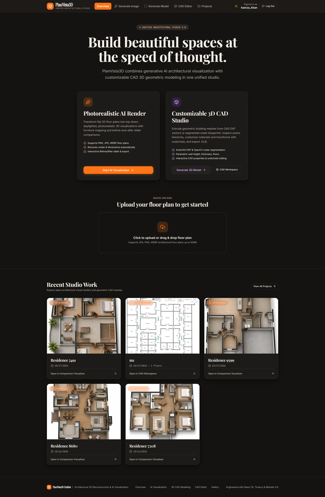
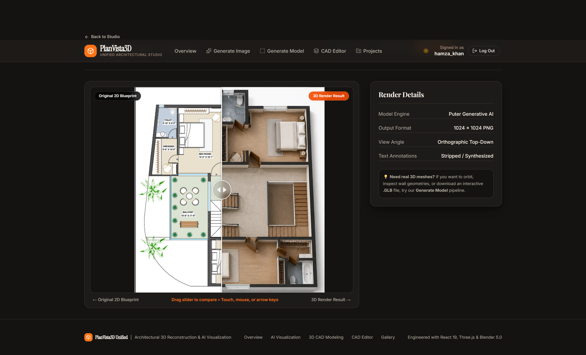
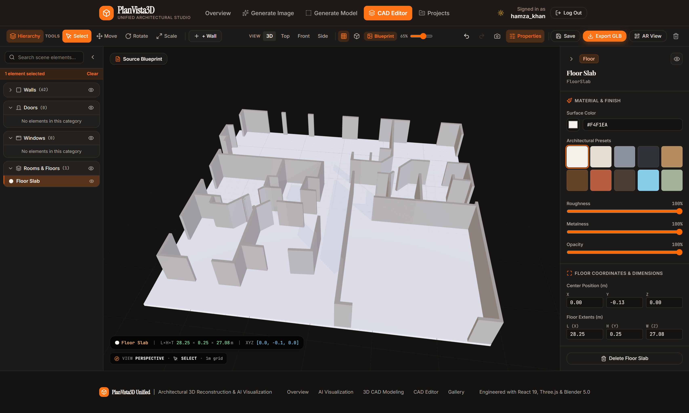
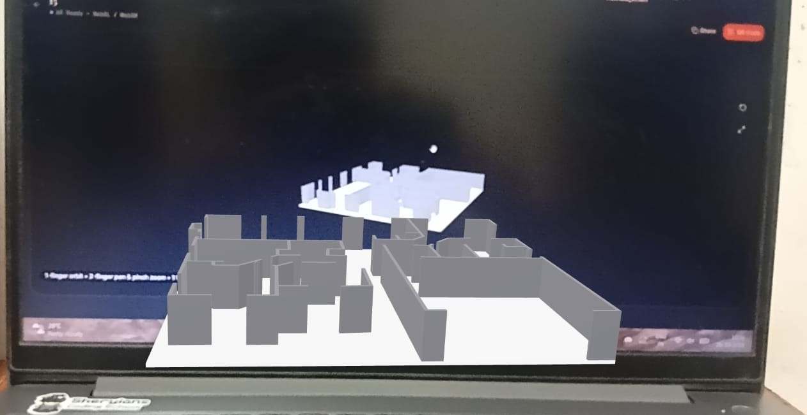

# PlanVista3D — Unified Architectural Studio

**Transform architectural floor plans into visualizations and interactive 3D building models.**

PlanVista3D is a web-based architectural visualization platform that combines AI-powered blueprint visualization with 3D geometric modeling in one unified workspace. It brings image generation, 3D model viewing, CAD editing, project management, and AR model viewing together.

**Live Demo:** https://planvista3d.onrender.com/  
**Repository:** https://github.com/hamzaKhan2004/PlanVista3D_Unified

---

## Screenshots

<!-- Add your screenshots to the assets/screenshots/ directory and replace these placeholders. -->

| Overview | Architectural Visualization |
|---|---|
|  | 

| 3D CAD Editor | AR Model Viewer |
|---|---|
|  |  |

## Features

- **AI-Powered Blueprint Visualization:** Generate architectural visualizations from 2D floor-plan images.
- **3D Building Modeling:** Generate and view 3D architectural models using the existing modeling workflow.
- **Interactive CAD Editor:** Inspect and customize supported 3D models using the existing editor.
- **Model Export:** Export supported 3D models in GLB format.
- **Project Management:** Save and access projects through the application's existing persistence workflow.
- **AR Model Viewing:** Open supported shared 3D models in a compatible browser or AR environment.

## Technology Stack

| Area | Technologies |
|---|---|
| Frontend | React, JavaScript, Vite, Tailwind CSS |
| 3D Visualization | Three.js, React Three Fiber |
| Backend | Python, Flask |
| Image Processing | OpenCV |
| 3D Modeling | Blender |
| Authentication | Puter.js |
| Data and Storage | MongoDB Atlas, Amazon S3, ImageKit |

## Architecture Overview

1. Users interact with the React frontend to generate visualizations or work with 3D models.
2. The Flask backend handles supported processing and model-generation workflows.
3. OpenCV and Blender support the existing blueprint-processing and 3D-modeling pipeline.
4. Project metadata and assets are persisted using the configured storage services.
5. The frontend displays supported models in the CAD Editor and AR viewing workflow.

## Getting Started

### Prerequisites

- Node.js and npm
- Python compatible with the backend dependencies
- Git
- Required service credentials for the features you want to run

### Installation

Clone the repository:

```bash
git clone https://github.com/hamzaKhan2004/PlanVista3D_Unified.git
cd PlanVista3D
```

Install frontend dependencies from the directory containing the frontend `package.json`:

```bash
cd frontend
npm install
```

Configure the frontend environment using the variable names documented in the frontend `.env.example`, then start the development server:

```bash
npm run dev
```

For the backend, open a separate terminal and follow the Python setup instructions and dependency files in the backend directory. Configure required backend variables using the supplied `.env.example` before starting Flask.

> Keep real API keys, database credentials, and storage secrets out of source control. Do not commit `.env` files containing secrets.

## Environment Configuration

Review the repository's `.env.example` files to identify the variables required for each service. Depending on the features enabled, these may include:

- Frontend API base URL
- Puter authentication configuration
- MongoDB Atlas connection settings
- Amazon S3 configuration
- ImageKit configuration
- Blender and Python runtime requirements

Use actual variable names from the repository when configuring local development or deployment.

## Deployment

The application has a live frontend hosted on Render. Refer to the deployment and Docker configuration in the repository for the backend setup and required environment variables.

The availability of individual features depends on the corresponding services and production configuration.

## Project Motivation

This project was inspired by the 2024 Smart India Hackathon (SIH) problem statement concerning the conversion of 2D architectural blueprints into 3D models. It explores how image processing, architectural visualization, and interactive 3D tools can be combined in a single web application.

## Future Improvements

- Improve architectural geometry reconstruction and model quality.
- Enhance responsive CAD editing and cross-device AR compatibility.
- Optimize model-generation performance and storage workflows.

## License

No license has been specified here. Add a `LICENSE` file if you intend to grant others permission to use, modify, or distribute this project.
