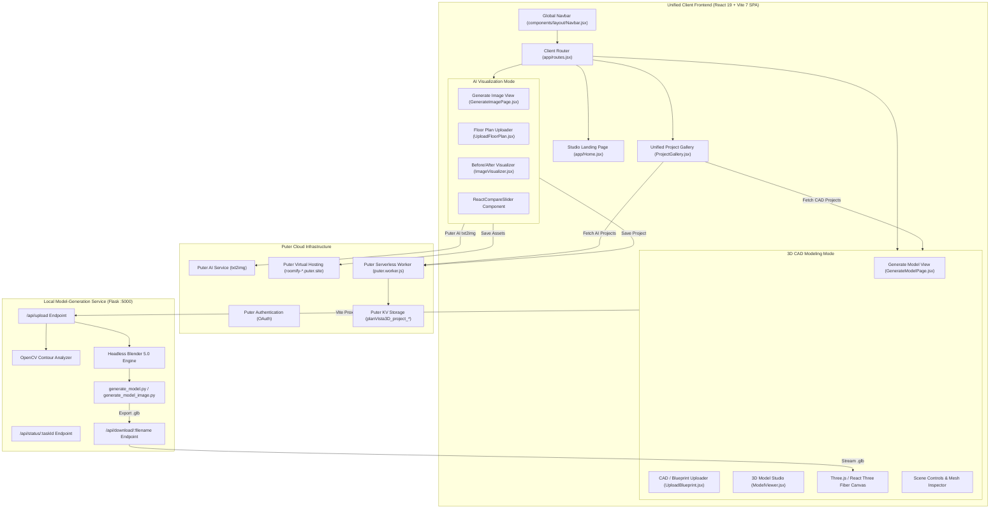
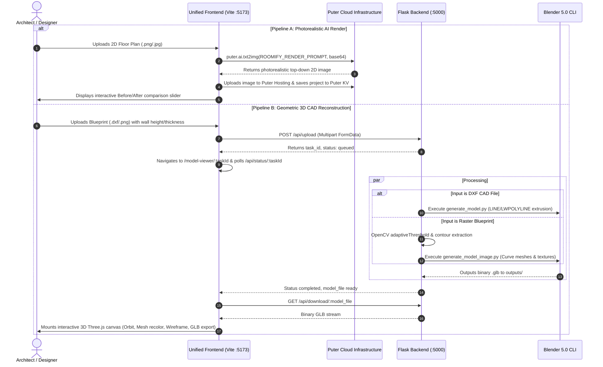

# Current Architecture & System Topography: Unified PlanVista3D

## 1. Unified Application Source Layout

The application has been unified into a single full-stack project under the application root, with preserved original repositories maintained as migration references:

```
d:/Mern Projects/PlanVist3D/
├── frontend/                          # Unified React 19 + Vite 7 SPA (JavaScript / JSX)
│   ├── public/                        # Static assets, blueprints, icons
│   │   ├── favicon.ico
│   │   └── (Sample blueprints b1.jpg - b8.png)
│   ├── src/
│   │   ├── app/                       # Application Shell & Routing
│   │   │   ├── App.jsx                # Top-level BrowserRouter wrapper
│   │   │   ├── Home.jsx               # Studio landing page with dual-mode cards & recent gallery
│   │   │   └── routes.jsx             # React Router route declarations
│   │   ├── components/                # Reusable UI Primitives & Layout
│   │   │   ├── layout/
│   │   │   │   ├── Navbar.jsx         # Header navigation bar & Puter login/logout
│   │   │   │   └── AppLayout.jsx      # Top-level shell providing AuthContext
│   │   │   ├── ui/
│   │   │   │   └── Button.jsx         # Roomify-themed button component
│   │   │   └── projects/
│   │   │       └── ProjectCard.jsx    # Dual-mode project card with dynamic badges
│   │   ├── features/                  # Business Domain Modules
│   │   │   ├── image-generation/
│   │   │   │   ├── GenerateImagePage.jsx # Dedicated 2D AI render generation view
│   │   │   │   ├── UploadFloorPlan.jsx   # Drag-and-drop floor-plan uploader
│   │   │   │   └── ImageVisualizer.jsx   # Before/After comparison slider view
│   │   │   ├── model-generation/
│   │   │   │   ├── GenerateModelPage.jsx # Dedicated 3D CAD model generation view
│   │   │   │   ├── UploadBlueprint.jsx   # Blueprint upload form with parameter inputs
│   │   │   │   ├── ModelViewer.jsx       # 3D canvas viewer, toolbars & controls
│   │   │   │   └── Advanced3DEditor.jsx  # Interactive R3F canvas, raycasting, materials
│   │   │   └── project-gallery/
│   │   │       └── ProjectGallery.jsx    # Unified project gallery with category filters
│   │   ├── lib/                       # API Clients & Utilities
│   │   │   ├── puter/
│   │   │   │   ├── puter.action.js    # Puter SDK auth & project CRUD operations
│   │   │   │   ├── puter.hosting.js   # Puter virtual hosting & file writing
│   │   │   │   └── ai.action.js       # Puter AI txt2img bridge & image formatting
│   │   │   ├── api/
│   │   │   │   └── modelApi.js        # Flask model generation API client & local persistence
│   │   │   └── utils/
│   │   │       ├── constants.js       # Render prompts, timing constants, storage paths
│   │   │       └── utils.js           # Blob, DataURL, and MIME parsing helpers
│   │   ├── styles/
│   │   │   └── index.css              # Roomify Tailwind v4 theme, design tokens, buttons
│   │   └── main.jsx                   # React 19 client entry point
│   ├── index.html                     # HTML host with Instrument Serif & Inter fonts
│   ├── package.json                   # Client dependencies (React 19, Three.js, Puter, etc.)
│   └── vite.config.js                 # Vite config with path alias and /api proxy to Flask (:5000)
│
├── backend/
│   └── model-generation/              # Python Flask 3D Reconstruction Service
│       ├── app.py                     # Flask API gateway, OpenCV contours, task scheduler
│       ├── generate_model.py          # Blender script for DXF vector extrusion
│       ├── generate_model_image.py    # Blender script for image contour geometry
│       ├── blueprint_to_3d.py         # Secure Vision LLM test prototype
│       ├── requirements.txt           # Python backend dependencies
│       ├── test_backend.py            # Unit & regression test suite for Flask endpoints
│       ├── test_e2e_pipeline.py       # End-to-end Blender 5.0 GLB generation test suite
│       ├── textures/                  # Material textures (wood_floor2.jpg)
│       ├── uploads/                   # Blueprint uploads & intermediate JSON configs
│       └── outputs/                   # Generated .glb 3D mesh files
│
├── workers/
│   └── puter/
│       └── puter.worker.js            # Puter Serverless Worker for KV project persistence
│
├── docs/
│   └── architecture/                  # Complete 12-document architecture package
│
├── PlanVistaRoomify/                  # [Preserved Reference] Original Roomify codebase
├── PlanVista3D/                       # [Preserved Reference] Original PlanVista3D codebase
├── .env.example                       # Environment configuration template
└── README.md                          # Master project documentation
```

---

## 2. Architecture Diagrams

### Diagram 1: Unified Application Architecture



---

### Diagram 2: Dual Pipeline Processing Lifecycle


