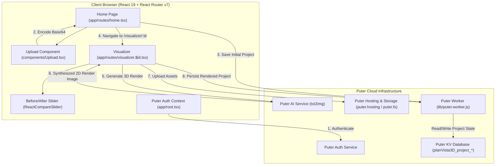
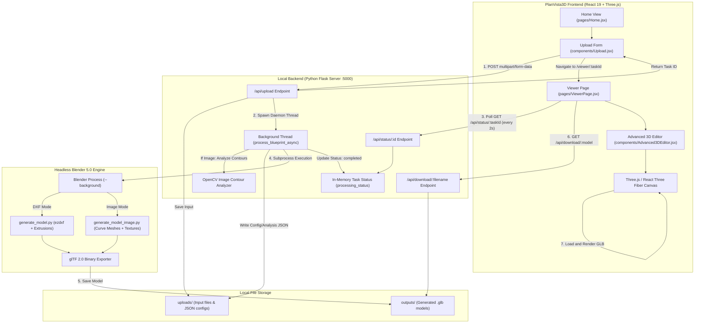
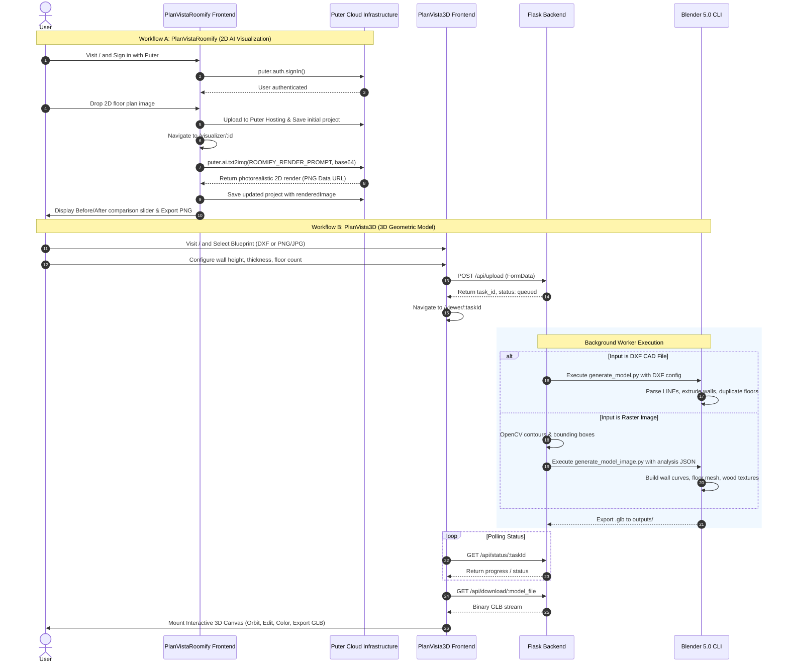
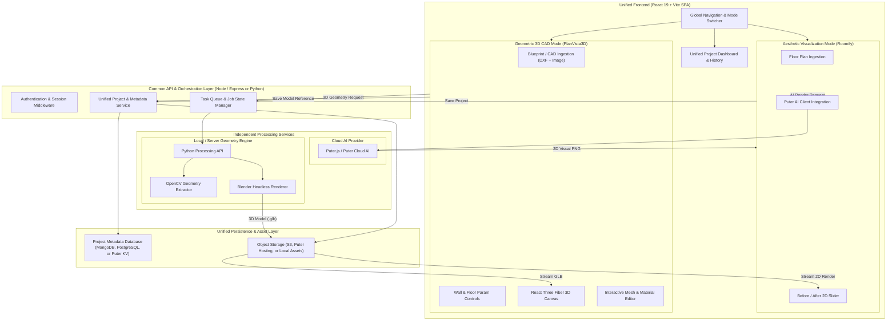

# Current Architecture & System Topography

## 1. Clean Workspace Source Layout

Excluding node packages, Python virtual environments, build artifacts, test CAD/image collections, and temporary outputs, the meaningful source tree consists of the following components:

```
d:/Mern Projects/PlanVist3D/
├── PlanVistaRoomify/
│   ├── app/
│   │   ├── routes/
│   │   │   ├── home.tsx               # Landing page, hero, project grid, upload trigger
│   │   │   └── visualizer.$id.tsx     # Comparison visualizer, Puter AI render trigger, export
│   │   ├── app.css                    # Tailwind v4 theme, design tokens, component styles
│   │   ├── root.tsx                   # HTML document shell, Puter auth provider, error boundary
│   │   └── routes.ts                  # React Router v7 route declaration index
│   ├── components/
│   │   ├── ui/
│   │   │   └── Button.tsx             # Shared button component with variants & sizes
│   │   ├── Navbar.tsx                 # Header navigation bar with Puter login/logout
│   │   └── Upload.tsx                 # Drag-and-drop floor plan uploader
│   ├── lib/
│   │   ├── ai.action.ts               # puter.ai.txt2img wrapper and image formatting
│   │   ├── constants.ts               # Storage keys, render prompts, UI dimension constants
│   │   ├── puter.action.ts            # High-level Puter SDK bridge (auth, projects, hosting)
│   │   ├── puter.hosting.ts           # Puter virtual hosting configuration & file writing
│   │   ├── puter.worker.js            # Serverless worker script for CRUD project endpoints
│   │   └── utils.ts                   # Blob conversion, Base64 parsing, URL utilities
│   ├── Dockerfile                     # Multi-stage production container manifest
│   ├── package.json                   # Node dependencies and scripts
│   ├── react-router.config.ts         # React Router SSR configuration
│   ├── tsconfig.json                  # TypeScript compiler settings & path mapping
│   ├── type.d.ts                      # Ambient TypeScript type definitions
│   └── vite.config.ts                 # Vite bundler configuration
│
└── PlanVista3D/
    ├── backend/
    │   ├── app.py                     # Flask HTTP API, task scheduler, OpenCV analysis
    │   ├── blueprint_to_3d.py         # [Prototype] OpenRouter Molmo Vision pipeline script
    │   ├── generate_model.py          # Blender headless script for DXF vector extrusion
    │   ├── generate_model_image.py    # Blender headless script for raster contour geometry
    │   ├── textures/
    │   │   ├── wood_floor.jpg         # Sample floor texture asset
    │   │   └── wood_floor2.jpg        # Active floor texture asset applied in Blender
    │   └── .env                       # Commented API key and model config reference
    │
    ├── frontend/
    │   ├── src/
    │   │   ├── components/
    │   │   │   ├── Advanced3DEditor.jsx  # Interactive Three.js editor, hierarchy & toolbars
    │   │   │   ├── Layout.jsx            # Shared page shell and header
    │   │   │   ├── Upload.jsx            # Multipart upload form with wall & floor parameters
    │   │   │   └── Viewer3D.jsx          # Basic Three.js canvas viewer component
    │   │   ├── pages/
    │   │   │   ├── Home.jsx              # Landing page and blueprint upload container
    │   │   │   └── ViewerPage.jsx        # Full 3D inspection workspace, polling, edit tools
    │   │   ├── App.jsx                   # React Router DOM route definitions
    │   │   ├── index.css                 # Tailwind v4 directives and base styles
    │   │   └── main.jsx                  # React DOM root entry point
    │   ├── eslint.config.js           # ESLint flat configuration
    │   ├── index.html                 # HTML host document
    │   ├── package.json               # Frontend dependencies and scripts
    │   └── vite.config.js             # Vite configuration with `/api` proxy to port 5000
    │
    └── imp.txt                        # Reference Blender DXF addon script
```

---

## 2. Core Entry Points & Lifecycles

### PlanVistaRoomify Entry Points

1. **Development Runtime Entry**:
   - `npm run dev` executes `react-router dev`.
   - Reads `react-router.config.ts` (sets `ssr: true`) and `vite.config.ts`.
   - Loads route map from `app/routes.ts`, binding `/` to `app/routes/home.tsx` and `/visualizer/:id` to `app/routes/visualizer.$id.tsx`.
2. **Client Hydration Root**:
   - `app/root.tsx` renders the outer HTML document (`<head>`, `<Meta>`, `<Links>`, `<body>`, `<ScrollRestoration>`, `<Scripts>`).
   - Automatically initializes authentication check by calling `getCurrentUser()` via `lib/puter.action.ts`.
3. **Puter Worker Entry**:
   - `lib/puter.worker.js` runs on Puter Cloud infrastructure, exposing route handlers for `/api/projects/save`, `/api/projects/list`, and `/api/projects/get`.

### PlanVista3D Entry Points

1. **Backend Flask Entry**:
   - `python app.py` starts Flask on `0.0.0.0:5000` with `debug=True`.
   - Initializes `uploads/` and `outputs/` directories.
   - Registers routes: `/api/upload` (POST), `/api/status/<task_id>` (GET), `/api/download/<filename>` (GET), and `/api/health` (GET).
2. **Frontend SPA Entry**:
   - `npm run dev` inside `PlanVista3D/frontend` executes `vite`.
   - Serves `index.html`, which imports `src/main.jsx`.
   - `src/main.jsx` mounts `src/App.jsx` using `BrowserRouter`.
3. **Blender Headless CLI Scripts**:
   - Invoked dynamically by `app.py` via `subprocess.run`:
     - DXF Pipeline: `blender.exe --background --python generate_model.py -- <config.json> <output.glb>`
     - Image Pipeline: `blender.exe --background --python generate_model_image.py -- <analysis.json> <output.glb>`

---

## 3. Architecture Diagrams

### Diagram 1: PlanVistaRoomify Architecture



---

### Diagram 2: PlanVista3D Architecture



---

### Diagram 3: End-to-End User Workflows



---

### Diagram 4: Proposed Unified Architecture (PROPOSAL ONLY)

> [!IMPORTANT]
> The following diagram represents a **proposed architecture** for future development. It is **NOT** currently implemented.



---

## 4. Runtime and Deployment Boundaries

| Boundary | PlanVistaRoomify | PlanVista3D |
|---|---|---|
| **Client Execution** | Runs in modern browser with Web Workers | Runs in WebGL-capable browser |
| **Server Runtime** | Node.js (via `@react-router/serve` in container) | Python 3.13 (Flask) + Blender 5.0 executable |
| **External Network Dependency** | Requires active internet access to connect to `puter.com` and `puter.work` | Completely local offline execution (excluding the orphaned `blueprint_to_3d.py`) |
| **Operating System Coupling** | Platform-independent Node container (`node:20-alpine`) | Strongly coupled to Windows host paths (`C:\Program Files\Blender Foundation\...`, `C:\Users\Hamza Khan\...`) |
| **Memory & Concurrency** | Stateless server; processing offloaded to Puter Cloud | Local CPU/GPU spikes during Blender headless sub-processes (takes ~5–20s per build) |
